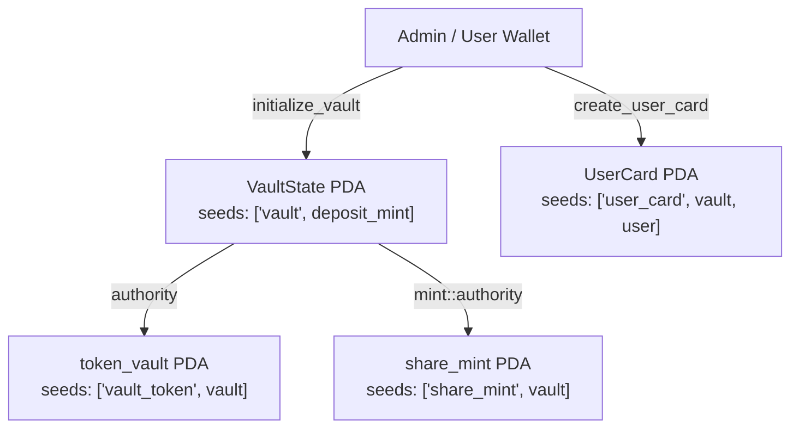

# Liquidity Vault — Сквозной проект курса Solana (Недели 8–15)

Полнофункциональное хранилище ликвидности (**Liquidity Vault**) на базе **Anchor 1.2.2 (Rust)**, интегрированное с концентрированным маркет-мейкером **Raydium CLMM** в сети **Solana Devnet** без использования TypeScript SDK для ончейн-операций, с модульными и интеграционными тестами на **LiteSVM** и веб-интерфейсом на **Next.js 16 + Solana Wallet Adapter**.

---

## Работа по неделям

| Неделя | Тема | Страница |
|---|---|---|
| 8 | Каркас vault, PDA и карточка пользователя | [docs/weeks/week-08](docs/weeks/week-08/) |
| 9 | Депозит и share-токены | [docs/weeks/week-09](docs/weeks/week-09/) |
| 10 | CPI и вывод средств | [docs/weeks/week-10](docs/weeks/week-10/) |
| 11 | Raydium CLMM: пул и концентрированная позиция | [docs/weeks/week-11](docs/weeks/week-11/) |
| 12 | Strategy и swap через CPI в Raydium | [docs/weeks/week-12](docs/weeks/week-12/) |
| 13 | Позиция vault в CLMM, комиссии и ребалансировка | [docs/weeks/week-13](docs/weeks/week-13/) |
| 14 | Интеграция: фронтенд и тесты | [docs/weeks/week-14](docs/weeks/week-14/) |
| 15 | Demo Day и защита | [docs/weeks/week-15](docs/weeks/week-15/) |

---

## Оглавление

1. [Структура репозитория](#1-структура-репозитория)
2. [Быстрый старт (Сборка, тесты, CLI и фронтенд)](#2-быстрый-старт-сборка-тесты-cli-и-фронтенд)
3. [Сводная таблица адресов в Solana Devnet](#3-сводная-таблица-адресов-в-solana-devnet)
4. [Неделя 8 — Каркас программы и карточки пользователей (PDA)](#4-неделя-8--каркас-программы-и-карточки-пользователей-pda)
5. [Неделя 9 — Депозит и математика долей (Share Tokens)](#5-неделя-9--депозит-и-математика-долей-share-tokens)
6. [Неделя 10 — Вывод средств (Withdraw) и CPI с подписью PDA](#6-неделя-10--вывод-средств-withdraw-и-cpi-с-подписью-pda)
7. [Неделя 11 — Пул Raydium CLMM и открытие позиции в диапазоне тиков](#7-неделя-11--пул-raydium-clmm-и-открытие-позиции-в-диапазоне-тиков)
8. [Неделя 12 — Стратегия и Swap хранилища через CPI в Raydium CLMM](#8-неделя-12--стратегия-и-swap-хранилища-через-cpi-в-raydium-clmm)
9. [Неделя 13 — Позиция Vault в Raydium CLMM, сбор комиссий, Impermanent Loss и ребалансировка](#9-неделя-13--позиция-vault-в-raydium-clmm-сбор-комиссий-impermanent-loss-и-ребалансировка)
10. [Неделя 14 — Интеграция (Capstone Build Week: Фронтенд + Тесты)](#10-неделя-14--интеграция-capstone-build-week-фронтенд--тесты)
11. [Недели 15–16 — Demo Day и защита проекта](#11-недели-1516--demo-day-и-защита-проекта)
12. [Исправления после ревью](#12-исправления-после-ревью)

---

## 1. Структура репозитория

```text
Liquidity Vault/
├── Anchor.toml                         # Конфигурация программы для localnet и devnet
├── Cargo.toml                          # Workspace: программа liquidity-vault и CLI vault-client
├── rust-toolchain.toml                 # Фиксация инструментария Rust
├── README.md                           # Документация проекта и ссылки на транзакции в Devnet
├── docs/
│   ├── weeks/week-08 … week-15/        # Страница на каждую неделю: код, тесты, транзакции
│   ├── demo-day-and-defense.md         # Сценарий Demo Day (неделя 15) и ответы к защите (неделя 16)
│   └── AI/
│       ├── README.md                   # Маршрутизатор архитектурных правил
│       └── scopes/vault.md             # Правила разработки программы, CPI и клиента
├── programs/
│   └── liquidity-vault/
│       ├── src/
│       │   ├── lib.rs                  # Точка входа программы и 9 инструкций
│       │   ├── state.rs                # Аккаунты VaultState, UserCard, Strategy и их PDA seeds
│       │   ├── error.rs                # Коды ошибок VaultError
│       │   ├── math.rs                 # Расчёт долей и вывода в u128 с округлением в пользу пула
│       │   ├── nav.rs                  # Полная стоимость хранилища (token_vault + secondary_vault)
│       │   ├── raydium.rs              # Ручной парсер PoolState/PersonalPosition и CPI в Raydium CLMM
│       │   └── instructions/           # Обработчики всех инструкций (недели 8–13)
│       └── tests/
│           └── vault.rs                # Интеграционные тесты LiteSVM (недели 8–13)
├── clients/
│   └── vault-client/
│       └── src/
│           ├── main.rs                 # CLI-команды для всех недель (init, card, deposit, withdraw, ...)
│           ├── rpc.rs                  # JSON-RPC, проверка genesis hash, simulateTransaction
│           ├── vault.rs                # Операции хранилища (недели 8–10)
│           ├── raydium.rs              # Математика Q64.64, тики и сборка инструкций Raydium CLMM
│           ├── pool.rs                 # Создание токенов, пула и позиции кошелька (неделя 11)
│           ├── strategy.rs             # Инициализация стратегии и CPI swap со slippage (неделя 12)
│           └── position.rs             # Открытие/сбор комиссий/закрытие/ребаланс позиции (неделя 13)
└── app/                                # Веб-интерфейс Next.js 16 + Wallet Adapter (неделя 14)
```

---

## 2. Быстрый старт (Сборка, тесты, CLI и фронтенд)

### Сборка SBF-программы и запуск тестов LiteSVM
```bash
# Сборка SBF-бинарника программы
cargo build-sbf --manifest-path programs/liquidity-vault/Cargo.toml

# Запуск всех интеграционных тестов LiteSVM (недели 8–13)
cargo test -p liquidity-vault --test vault
```

### Команды Rust-клиента (`vault-client`)
```bash
# Просмотр полного состояния хранилища, карточки пользователя и стратегии в Devnet
cargo run -p vault-client -- show --cluster devnet

# Просмотр состояния пула Raydium CLMM в Devnet
cargo run -p vault-client -- pool --cluster devnet

# Неделя 8: инициализация хранилища и создание карточки пользователя
cargo run -p vault-client -- init --cluster devnet
cargo run -p vault-client -- card --cluster devnet

# Неделя 9: депозит 1000 токенов
cargo run -p vault-client -- deposit --amount 1000 --cluster devnet

# Неделя 10: вывод 200 share-токенов (min_amount_out = ожидаемая сумма − 0.5%)
cargo run -p vault-client -- withdraw --shares 200 --slippage-bps 50 --cluster devnet

# Неделя 11: выпуск токена, создание пула Raydium CLMM и позиции кошелька
cargo run -p vault-client -- create-token --decimals 6 --supply 1000000 --cluster devnet
cargo run -p vault-client -- create-pool --price 1.0 --cluster devnet
cargo run -p vault-client -- open-position --amount-0 50000 --amount-1 50000 --cluster devnet

# Неделя 12: инициализация стратегии и обмен через CPI (успешный и отклонённый по slippage)
cargo run -p vault-client -- strategy --cluster devnet
cargo run -p vault-client -- vault-swap --amount 300 --a-to-b --slippage-bps 100 --cluster devnet
cargo run -p vault-client -- vault-swap --amount 50 --a-to-b --reject --cluster devnet

# Неделя 13: позиция Vault в CLMM, внешние свопы трейдеров, сбор комиссий, закрытие и ребалансировка
cargo run -p vault-client -- vault-open-position --amount-0 200 --amount-1 200 --cluster devnet
cargo run -p vault-client -- trader-swap --amount 5000 --zero-for-one --cluster devnet
cargo run -p vault-client -- vault-collect-fees --cluster devnet
cargo run -p vault-client -- vault-close-position --slippage-bps 100 --cluster devnet
cargo run -p vault-client -- vault-rebalance --amount-0 150 --amount-1 150 --cluster devnet
```

### Запуск веб-приложения (Неделя 14)
```bash
cd app
npm install
npm run dev   # http://localhost:3015
```

---

## 3. Сводная таблица адресов в Solana Devnet

> [!NOTE]
> Транзакции в этом README выполнены предыдущей версией программы. После исправления
> расчёта долей (раздел 12) инструкции `deposit` и `withdraw` принимают три дополнительных
> аккаунта (`strategy`, `secondary_vault`, `pool_state`), а `withdraw` — аргумент
> `min_amount_out`. Чтобы повторить транзакции, программу нужно передеплоить ключом
> upgrade authority.

| Сущность | Адрес в Solana Devnet | Ссылка в Solana Explorer |
|---|---|---|
| Программа `liquidity_vault` | `CFvWtQbdLxeJz55CfJLbpqyqFaUFsNZPuWMU7KcPgnE2` | [Explorer](https://explorer.solana.com/address/CFvWtQbdLxeJz55CfJLbpqyqFaUFsNZPuWMU7KcPgnE2?cluster=devnet) |
| Программа Raydium CLMM (Devnet) | `devi51mZmdwUJGU9hjN27vEz64Gps7uUefqxg27EAtH` | [Explorer](https://explorer.solana.com/address/devi51mZmdwUJGU9hjN27vEz64Gps7uUefqxg27EAtH?cluster=devnet) |
| Конфигурация пула `AmmConfig` (0.25%, `tick_spacing = 60`) | `B9H7TR8PSjJT7nuW2tuPkFC63z7drtMZ4LoCtD7PrCN1` | [Explorer](https://explorer.solana.com/address/B9H7TR8PSjJT7nuW2tuPkFC63z7drtMZ4LoCtD7PrCN1?cluster=devnet) |
| Токен депозита `deposit_mint` (`token_mint_0`, 6 decimals) | `wKGeYnbJWf2iqakmqFkYGcnmWHQ2roJ6jJ1664Zf2oR` | [Explorer](https://explorer.solana.com/address/wKGeYnbJWf2iqakmqFkYGcnmWHQ2roJ6jJ1664Zf2oR?cluster=devnet) |
| Второй токен `secondary_mint` (`token_mint_1`, 6 decimals) | `EWXdK61y5MT8HfZypYJBLNj2A2paRAc5pXojcpeFkRwu` | [Explorer](https://explorer.solana.com/address/EWXdK61y5MT8HfZypYJBLNj2A2paRAc5pXojcpeFkRwu?cluster=devnet) |
| Главный аккаунт `VaultState` PDA | `5vwYp3a9BaEHuduEY5fHikBvdgWpJJnVvviVDFtfToz6` | [Explorer](https://explorer.solana.com/address/5vwYp3a9BaEHuduEY5fHikBvdgWpJJnVvviVDFtfToz6?cluster=devnet) |
| Хранилище базового токена `token_vault` PDA | `87XEkicQVnwpeXZP53J75PVRGyCJBqkHMwuhsvvicHcM` | [Explorer](https://explorer.solana.com/address/87XEkicQVnwpeXZP53J75PVRGyCJBqkHMwuhsvvicHcM?cluster=devnet) |
| Минт долевых токенов `share_mint` PDA | `H5BNpYGoYAFaxvWofCXGsCddKMcUG6dcqVU2Q6v13WtP` | [Explorer](https://explorer.solana.com/address/H5BNpYGoYAFaxvWofCXGsCddKMcUG6dcqVU2Q6v13WtP?cluster=devnet) |
| Карточка пользователя `UserCard` PDA | `AGG4U9RRc41fXxBS9wjYh3tWpoZJxGEUnw87aZQ5x7WW` | [Explorer](https://explorer.solana.com/address/AGG4U9RRc41fXxBS9wjYh3tWpoZJxGEUnw87aZQ5x7WW?cluster=devnet) |
| Стратегия `Strategy` PDA | `9PdTskG24DE7AA1QbtHBpQ8Jt6ocaUTEo6v3RPucJnDB` | [Explorer](https://explorer.solana.com/address/9PdTskG24DE7AA1QbtHBpQ8Jt6ocaUTEo6v3RPucJnDB?cluster=devnet) |
| Второе хранилище `secondary_vault` PDA | `EghNHFQ3a7JRQTgdXJXyPUHCrdhNuQcdRUpcsLEZwb7H` | [Explorer](https://explorer.solana.com/address/EghNHFQ3a7JRQTgdXJXyPUHCrdhNuQcdRUpcsLEZwb7H?cluster=devnet) |
| Пул Raydium CLMM `PoolState` PDA | `DKRQA3X9R6oneVnfgXEtCZdQmPRyASYV6rLXv7dBBD3n` | [Explorer](https://explorer.solana.com/address/DKRQA3X9R6oneVnfgXEtCZdQmPRyASYV6rLXv7dBBD3n?cluster=devnet) |
| Активная CLMM-позиция хранилища `PersonalPosition` | `ESMAEb6FqBBWKa5zVTt12u1qfbMxeNDFkPiZfzBZD434` | [Explorer](https://explorer.solana.com/address/ESMAEb6FqBBWKa5zVTt12u1qfbMxeNDFkPiZfzBZD434?cluster=devnet) |

---

## 4. Неделя 8 — Каркас программы и карточки пользователей (PDA)

### Схема аккаунтов и PDA Seeds



- **`VaultState`** (`seeds = [b"vault", deposit_mint.key().as_ref()]`): хранит `admin`, `deposit_mint`, `share_mint`, `token_vault`, `total_deposited`, `total_shares` и канонические `bump`-значения.
- **`UserCard`** (`seeds = [b"user_card", vault.key().as_ref(), user.key().as_ref()]`): хранит персональную статистику вкладчика (`vault`, `owner`, `deposited_amount`, `shares_minted`, `bump`).

### Транзакции Недели 8 в Solana Devnet
- **Деплой программы `liquidity_vault`**: [`4ZqotemkmCrHngZYCJzBKXoZBmgCCU9BU5dPoPFHJtZNV2pKnsGEGiZWjmvzbCSzQiu38mC65tdyXtQQ2jNbr861`](https://explorer.solana.com/tx/4ZqotemkmCrHngZYCJzBKXoZBmgCCU9BU5dPoPFHJtZNV2pKnsGEGiZWjmvzbCSzQiu38mC65tdyXtQQ2jNbr861?cluster=devnet)
- **Инициализация хранилища (`initialize_vault`)**: [`XQCpG81bjLAwqrhCf4T8GSna3eT9hXhWBkPxALgW5z78oSwpp4MKwsoaYqSEBer6PQs25P7uPHEh97u3jP3Pqwu`](https://explorer.solana.com/tx/XQCpG81bjLAwqrhCf4T8GSna3eT9hXhWBkPxALgW5z78oSwpp4MKwsoaYqSEBer6PQs25P7uPHEh97u3jP3Pqwu?cluster=devnet)
- **Создание карточки пользователя (`create_user_card`)**: [`3NDDdSVre3m4qVDzW6fzLSjGDv7V7Bx7HNCKwiSHbQmANnnubHhVQ3p5BC1ttv8zXBeqKnHwXP9gD8S5DUZ6pfQQ`](https://explorer.solana.com/tx/3NDDdSVre3m4qVDzW6fzLSjGDv7V7Bx7HNCKwiSHbQmANnnubHhVQ3p5BC1ttv8zXBeqKnHwXP9gD8S5DUZ6pfQQ?cluster=devnet)

---

## 5. Неделя 9 — Депозит и математика долей (Share Tokens)

### Формула расчёта долей
В модуле `programs/liquidity-vault/src/math.rs` реализована функция `calculate_shares_to_mint`:
Расчёт ведётся в `u128` с целочисленным делением вниз (в пользу хранилища) и виртуальной долей `+1`
в числителе и знаменателе (защита от атаки первого вкладчика через донат в `token_vault`):
  $$\text{shares} = \left\lfloor \frac{\text{amount} \times (\text{total\_shares} + 1)}{\text{NAV} + 1} \right\rfloor$$
- В пустом хранилище ($\text{total\_shares} = 0$, $\text{NAV} = 0$) доли выпускаются `1:1`.
- $\text{NAV}$ — полная стоимость хранилища в `deposit_mint` (`nav.rs`): остаток `token_vault` плюс остаток
  `secondary_vault`, пересчитанный по спотовой цене пула Raydium. Пока у стратегии открыта CLMM-позиция,
  `deposit` и `withdraw` отклоняются ошибкой `PositionActive`.
- Если из-за малого размера вклада $\text{shares} = 0$, возвращается ошибка `VaultError::ZeroShares`.

### Транзакция Недели 9 в Solana Devnet
- **Депозит `1000.0` токенов (`deposit`)**: [`MByYftZVVVcxMiacMW5vjQMgLzhHT5CPMau1hULKzSnoFvmBYpG7hUTEd5bh7qb5QcFrpvqhWbr4nTYuJGApQKu`](https://explorer.solana.com/tx/MByYftZVVVcxMiacMW5vjQMgLzhHT5CPMau1hULKzSnoFvmBYpG7hUTEd5bh7qb5QcFrpvqhWbr4nTYuJGApQKu?cluster=devnet)
  - Переведено в `token_vault`: `1000.0` (`1_000_000_000` raw)
  - Выпущено `share`-токенов через CPI `mint_to` с подписью `VaultState` PDA: `1000.0` (`1_000_000_000` raw)

---

